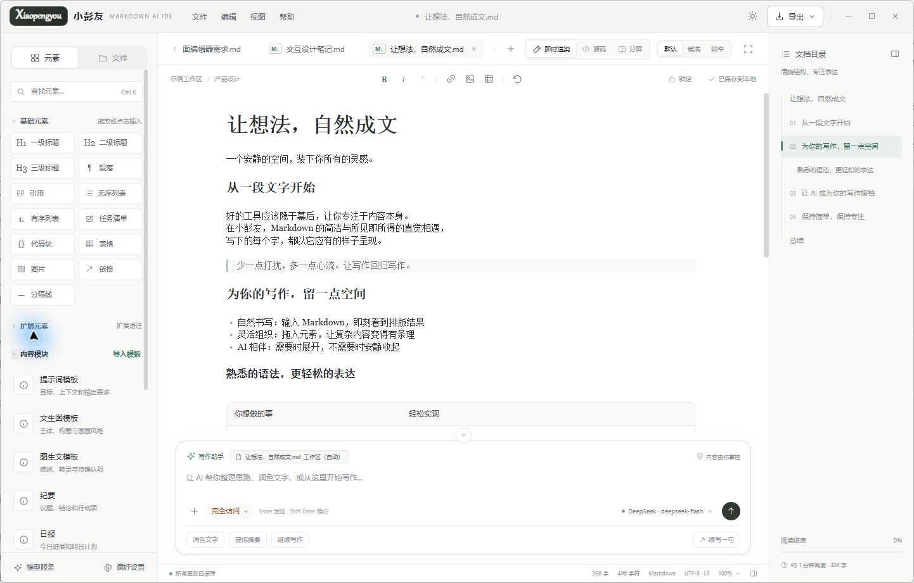
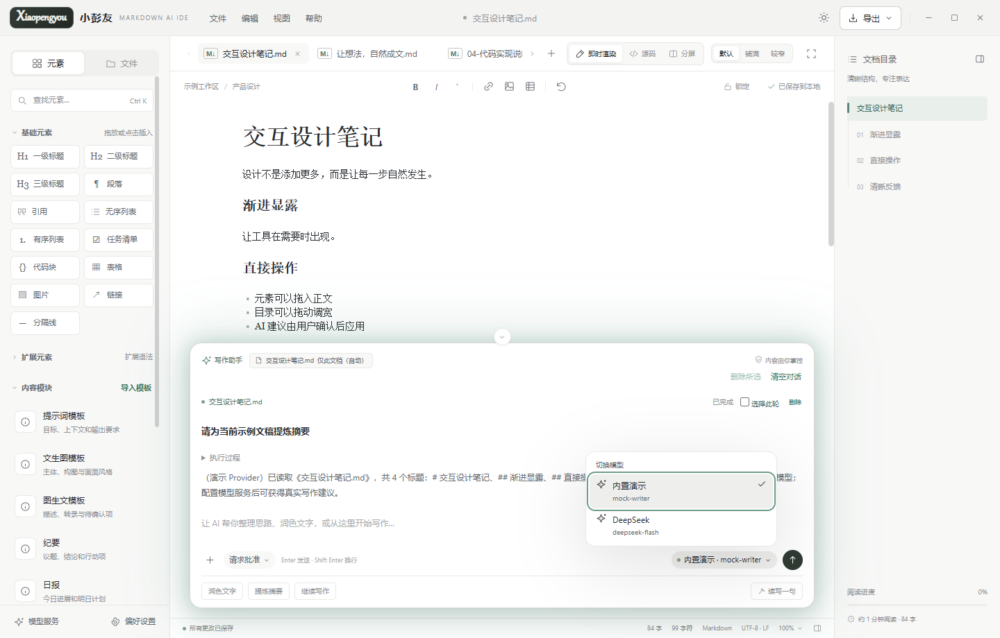

# 小彭友 · Markdown AI IDE

小彭友是一款开源、本地优先的 Markdown 桌面编辑器。拖入元素搭建文稿，用 AI 写作助手提问、润色和续写，并按需审阅 AI 修改。文稿以普通 `.md` 文件保存在磁盘，基础编辑无需账号。

[下载 Windows 安装包](https://github.com/WangLang1216/MarkdownAiIDE/releases/latest) · [功能与实现文档](docs/README.md) · [提交问题](https://github.com/WangLang1216/MarkdownAiIDE/issues)

## 元素交互

- **点选或拖放** · 从左侧元素面板将标题、任务清单、表格、图片和代码块插到正文。也可以在空行行首输入 `/` 调出快捷插入菜单：继续输入按名称过滤，`↑` `↓` 选择，`Enter` 插入，`Esc` 取消。
- **复用内容模板** · 内置纪要、日报和提示词等内容模块。可把自己的 Markdown 或纯文本模板导入侧栏，下次直接插入。
- **边写边看** · 在即时渲染、源码和分屏预览之间切换，共享同一份文稿与撤销历史。支持 KaTeX 公式、Mermaid 图表、脚注和文档目录。

## AI 写作助手

- **提问与编辑** · 让 AI 提炼摘要、润色或续写，也可以请它整理文稿。行内续写可用 `Tab` 接受、`Esc` 忽略。
- **范围与审批** · 可为任务选择当前文档、选中部分或工作区范围，并设置「请求批准」「帮我批准」或「完全访问」。在「请求批准」模式下，先看修改差异，再决定是否应用。
- **参考材料与上下文** · 可添加图片、网页及 Markdown、PDF、DOCX、XLSX、PPTX 等文件作为参考。编辑器里有选区时，输入框上方会出现「选中内容 · N 字」，发送时会把选中的原文一并交给模型，点一下即可取消。写作助手保留历史对话，便于回看与继续追问。
- **切换模型** · 可选内置离线演示，或接入 DeepSeek、Ollama、LM Studio 等 OpenAI 兼容服务。模型菜单会显示服务名称、模型 ID 和当前选项，右上角「模型配置」可直接打开模型服务设置。

## 工作区与导出

使用标签页、文件树、全文搜索和大纲管理本地文稿；在标签页之间来回切换时会保留每个文稿的滚动位置和光标，不用重新翻回原处。支持自动保存、草稿恢复、外部修改冲突提示、Typora CSS 主题导入，以及 PDF、HTML 和 Markdown 导出。安装 Pandoc 后可使用 DOCX、ODT、EPUB 等更多格式。

## 安装与启动

1. 打开 [GitHub Releases](https://github.com/WangLang1216/MarkdownAiIDE/releases/latest)，下载 Windows x64 的 `MarkdownAiIDE-1.0.5-x64-Setup.exe`。
2. 运行安装程序，按向导选择安装目录。
3. 从开始菜单或桌面快捷方式打开「小彭友」。通过「文件」打开 Markdown 文稿或工作区，也可以将 Markdown 文件拖到标签栏。

v1.0.5 提供未签名的 Windows x64 安装包。发布页也提供源码 ZIP 和 SHA-256 校验文件。

### 体验写作助手

在左下角打开「模型服务」，选择「内置演示（`mock-writer`）」，即可离线体验提案和审阅流程。使用真实模型时，添加 OpenAI 兼容服务并填入服务地址、模型名称和所需凭据。使用远程模型时，AI 请求所需的文稿内容和选用的参考材料会发送到所配置的服务。

## 从源码启动

使用 Git 和 Node.js 22.13+（推荐 Node.js 24 LTS），在终端执行：

~~~bash
git clone https://github.com/WangLang1216/MarkdownAiIDE.git
cd MarkdownAiIDE
npm ci
npm run dev
~~~

| 命令 | 用途 |
| --- | --- |
| `npm run dev` | 启动带热更新的 Electron DEV 版 |
| `npm run typecheck` | 检查主进程和渲染进程的 TypeScript 类型 |
| `npm test` | 运行 Vitest 单元测试 |
| `npm run build` | 检查类型并构建生产代码 |
| `npm run package` | 在 Windows 上生成 NSIS 安装包和更新清单，输出到 `dist/` |

发布新版时，先更新 `package.json` 和锁文件中的版本号。运行 `npm run package` 后，将同一次构建生成的安装包、`latest.yml` 和 `.blockmap` 上传到对应的 GitHub 正式发行版，例如 `v1.0.5`。上传时保留文件名，`latest.yml` 用于客户端下载与校验安装包。

项目基于 Electron、Vue 3、TypeScript 和 CodeMirror 6。模块划分、IPC、文档 Agent 与导出链路见[代码实现说明](docs/04-代码实现说明.md)。

## 许可证

项目源码采用 [MIT 许可证](LICENSE)。
