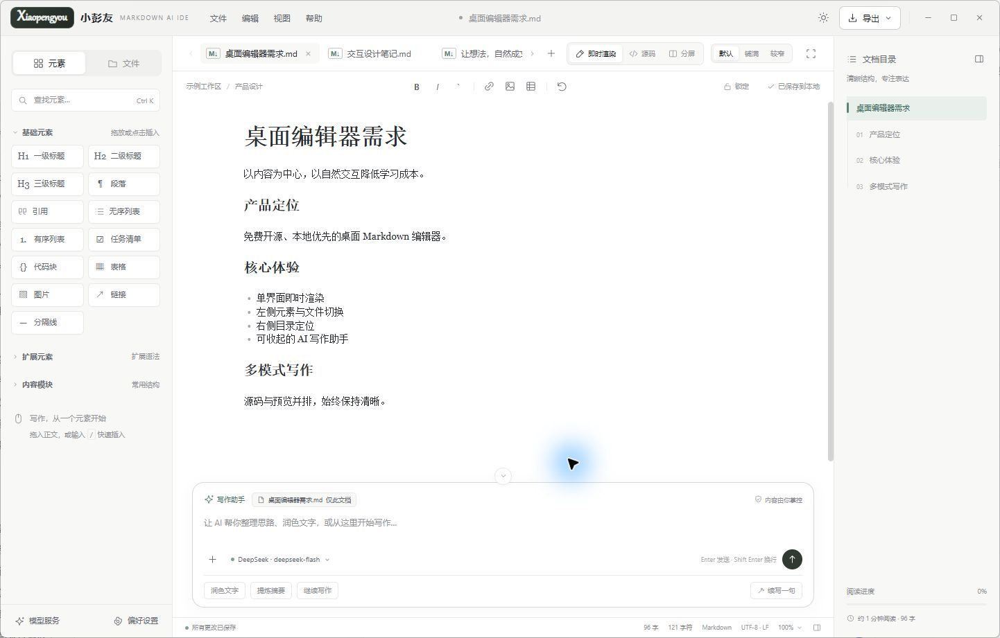
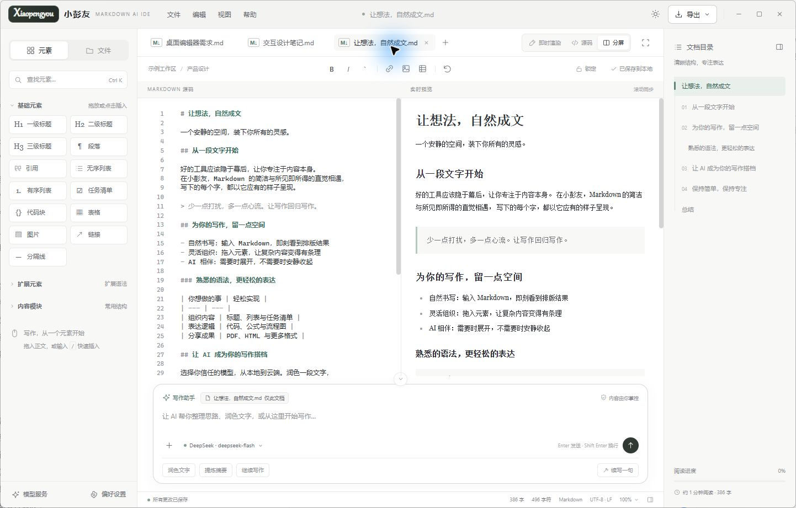

# 小彭友 · Markdown AI IDE

小彭友是一款本地优先的 Markdown 桌面编辑器。可以拖拽插入常用元素，也可以让 AI 润色、续写或整理文稿，在差异视图中审阅后应用。文稿以普通 `.md` 文件保存在磁盘，基础编辑无需账号。

[下载 Windows 安装包](https://github.com/WangLang1216/MarkdownAiIDE/releases/latest) · [功能与实现文档](docs/README.md) · [提交问题](https://github.com/WangLang1216/MarkdownAiIDE/issues)

## 界面截图

**即时渲染、元素面板与写作助手**

**Markdown 源码与实时预览分屏**

## 主要功能

- **三种编辑模式** · 在即时渲染、Markdown 源码和源码／预览分屏之间切换，共享文档和撤销历史。支持只读锁定与专注模式。
- **拖拽插入与扩展语法** · 从元素面板拖入标题、表格、图片和任务列表。支持代码高亮、脚注、KaTeX 公式、Mermaid 图表和文档目录。
- **可审阅的 AI 编辑** · 让写作助手润色、提炼摘要、续写或修改工作区文稿。可以先查看修改差异，再决定是否应用。行内续写候选可用 `Tab` 接受、`Esc` 忽略。
- **模型与参考材料** · 接入 OpenAI 兼容服务，包括 Ollama 和 LM Studio。支持添加 Markdown、TXT、DOCX、PDF、图片及公开网页作为参考，图片读取取决于模型的视觉能力。
- **本地工作区** · 使用文件树、标签页、文档大纲和全文搜索管理文稿。支持自动保存、恢复草稿和外部修改冲突提示。
- **主题与导出** · 支持浅色和深色外观、文稿排版设置与 Typora CSS 导入。可导出 PDF、HTML、Markdown 单文件或带图片的 ZIP，安装 Pandoc 后可使用 DOCX、ODT、EPUB 等更多格式。

## 安装与启动

1. 打开 [GitHub Releases](https://github.com/WangLang1216/MarkdownAiIDE/releases/latest)，下载 Windows x64 的 `MarkdownAiIDE-1.0.0-x64-Setup.exe`。
2. 运行安装程序，按向导选择安装目录。
3. 从开始菜单或桌面快捷方式打开「小彭友」。通过「文件」打开 Markdown 文稿或工作区，也可以将 Markdown 文件拖到标签栏。

v1.0.0 提供未签名的 Windows x64 安装包。发布页也提供源码 ZIP 和 SHA-256 校验文件。

### 体验写作助手

在左下角打开「模型服务」，选择「内置演示（`mock-writer`）」，即可离线体验提案和审阅流程。使用真实模型时，添加 OpenAI 兼容服务并填入服务地址、模型名称和所需凭据。使用远程模型时，AI 请求所需的文稿内容和选用的参考材料会发送到所配置的服务。

## 从源码启动

使用 Git 和 Node.js 22.13+（推荐 Node.js 24 LTS），在终端执行：

~~~bash
git clone https://github.com/WangLang1216/MarkdownAiIDE.git
cd MarkdownAiIDE
npm ci
npm run dev
~~~

| 命令 | 用途 |
| --- | --- |
| `npm run dev` | 启动带热更新的 Electron DEV 版 |
| `npm run typecheck` | 检查主进程和渲染进程的 TypeScript 类型 |
| `npm test` | 运行 Vitest 单元测试 |
| `npm run build` | 检查类型并构建生产代码 |
| `npm run package` | 在 Windows 上生成 NSIS 安装包，输出到 `dist/` |

项目基于 Electron、Vue 3、TypeScript 和 CodeMirror 6。模块划分、IPC、文档 Agent 与导出链路见[代码实现说明](docs/04-代码实现说明.md)。

## 许可证

项目源码采用 [MIT 许可证](LICENSE)。
