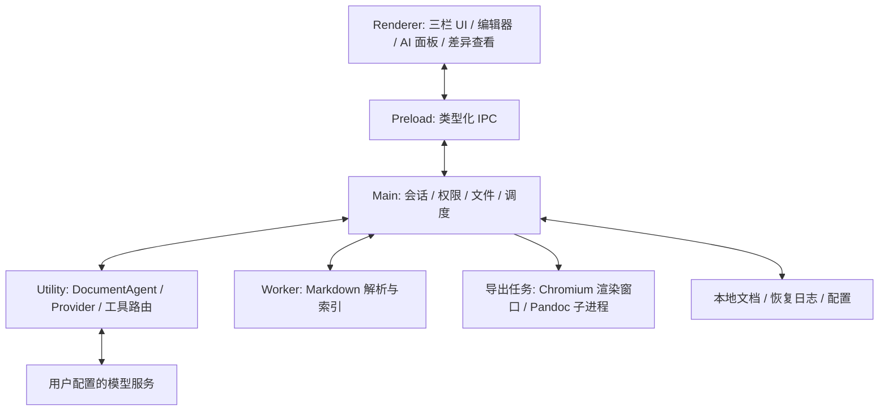
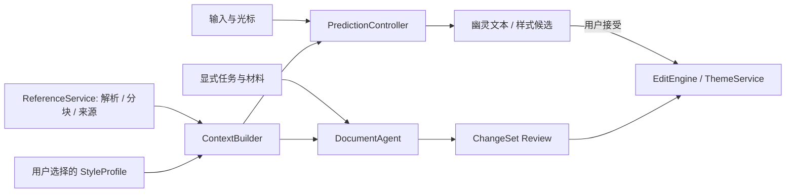

# MarkdownIDE 总体与 AI 集成方案

版本：V1.1 · 日期：2026-11-11 · 状态：建议架构，待验证。

关联：[产品需求](01-产品需求文档.md) · [技术项目文档](03-技术项目文档.md)。本文说明工程决策和执行流程；具体接口字段以技术项目文档为准。

## 1. 推荐路线

采用 Electron + Vue 3 + TypeScript，使用 Node.js 作为本地后端；复用成熟 Markdown 编辑内核，建设应用自有的 DocumentAgent、文档工具和修改执行器。模型使用用户配置的外部或本地服务，应用不训练模型。

先验证编辑和保存，再实现当前文档 AI 修改，再扩展其他文件创建、修改、删除及多文件任务。所有变更经过统一 ChangeSet 协议，避免为每个模型开发一套文件操作。

V1.1 文档进一步纳入内容/样式预测、图片/链接/文件参考与来源引用，详见第 15 节；它们复用现有会话、Provider 和修改引擎。

## 2. 桌面方案比较与决策

| 方案 | 价值 | 本项目成本 | 决策 |
| --- | --- | --- | --- |
| Electron + TypeScript | 跨平台统一 Chromium，MarkText 代码复用高；桌面与前端同语言 | 基础体积和内存较大，需按需加载和进程治理 | 当前采用 |
| Tauri 2 + Rust | 小体积、系统能力与权限模型有优势 | 重写桌面层，系统 WebView 差异增加主题、输入法和打印回归成本 | 保留替换边界，不安排首版迁移 |
| Wails + Go | Go 团队易开发本地业务，系统 WebView 轻量 | 与现有 MarkText 桌面层复用少，编辑器难题仍在前端 | 无现有 Go 代码资产时不优先 |
| 从零原生编辑器 | UI 和底层控制充分 | Markdown 往返、IME、表格、撤销和 CSS 主题成本极高 | 不采用 |

Electron 自带 Chromium/Node.js，适合这里对 CSS、富文本编辑行为和打印一致性的要求；这属于项目适配判断，不意味着 Electron 的输入延迟或内存必然优于其他框架。性能必须使用目标应用实测。[Electron 说明](https://www.electronjs.org/docs/latest/why-electron)

### 2.1 MarkText 复用策略

首选验证 MarkText/Muya，但不把“完整 Fork”和“复用编辑核心”混为一谈：

- 完整 Fork 能较快获得文件、窗口、设置等能力，但精简和后续合并存在成本。
- 只复用内核更适合新 UI、受控 IPC 和 Agent 命令接口，但要补全命令/事件/选区/事务适配。
- Spike 同时评估这两条路径，以往返数据完整性和实际接口成本决定最终方案。
- 无论选择哪条，都把 UI、文档状态、转换、主题和 AI 保持独立；不直接把演示原型当成编辑器内核。

MarkText 官方仓库与架构是核验入口，实际许可证及依赖应以选定提交为准。[MarkText](https://github.com/marktext/marktext) · [架构](https://github.com/marktext/marktext/blob/develop/packages/website/content/docs/dev/ARCHITECTURE.md)

## 3. 总体架构

Main 管理访问授权、文件资源和最终操作，不承担大段同步解析。Utility 中的 Agent 通过受控通道申请文档读取和变更，不持有不受限制的文件路径。生产代码可先把轻量调度置于 Main，但不能把长任务阻塞在其事件循环。

PDF 使用隐藏、沙箱化的渲染窗口与 `webContents.printToPDF`，由 Main 调度；UtilityProcess 自身不承担 DOM 页面排版。[Electron webContents](https://www.electronjs.org/docs/latest/api/web-contents)

## 4. Agent 与模型的边界

| 模型负责 | 应用负责 |
| --- | --- |
| 理解自然语言，提出目标候选 | 提供当前文档、工作区范围及真实候选 ID |
| 识别图片与组织表格数据 | 管理附件、校验容量、记录不确定单元格 |
| 选择读取工具、提出变更 | 校验参数、读缓冲区/磁盘、限制范围 |
| 生成文稿内容 | 插入位置、版本比较、命令事务、保存 |
| 根据执行结果解释完成情况 | 记录实际结果、恢复信息和失败状态 |

Agent 是应用内的任务编排层，不等于某一家模型，也不必是独立 HTTP 服务。首版采用应用自己管理的、有轮数和时间上限的工具调用循环。模型输出的 JSON、自然语言或“已完成”都不是执行事实；执行器返回的结果才是状态依据。

工具调用机制允许模型请求调用应用定义的函数，应用执行后将结果交回模型继续处理。[OpenAI Function Calling](https://developers.openai.com/api/docs/guides/function-calling)

应用自己拥有编辑器缓冲区和文件状态，适合在本地控制任务与工具。首版不需要云端 Agent 沙箱、任意代码执行或通用 Shell 工具；以后若出现不同运行需求，再评估托管 Agent 或外部框架。

## 5. 文档状态统一方案

### 5.1 唯一编辑状态

每个打开文档分配 `documentId`，由 DocumentSession 管理当前文本、单调递增 revision、dirty 状态和源文本指纹。Renderer 中的编辑视图与 Main 的文档服务通过有序事务同步。

- 已打开文档：读取最新会话快照，包含未保存内容。
- 未打开文件：读取磁盘，生成临时会话快照及磁盘指纹。
- 多窗口：同一物理文件只能有一个会话写入拥有者；其他窗口只读或转交，不维护彼此独立的可写副本。
- AI 启动和应用前均确认当前会话 revision；Renderer 尚未确认同步的修改不能被当成已纳入快照。

### 5.2 稳定定位

解析器提供标题路径、级别、父节点、文档内序号与章节源文本范围。Heading ID 绑定快照 revision，不保证重启或重解析后永久稳定。

“章节尾”由代码计算：找到标题之后第一个级别小于等于目标标题级别的标题，在其前插入；若无后继标题，则到文档结尾。不以屏幕位置、目录折叠状态或模型估算行号定位。

主状态以源文本及编辑器事务为准。AST 用于理解结构与定位，不默认全文重新输出 Markdown。对局部修改生成小范围源文本变更，保留未触及区域的排版写法。

## 6. 图片转表格用例

### 6.1 输入与必要澄清

用户输入“第二个标题尾部插入 4×2 表格，把图片内容填进去”，并附上图片。

上下文携带当前文档名称、版本、目录、附件 ID 和最近明确的表格约定。若无法确认“第二个标题”指哪个级别，返回具体候选名称；若行数是否含表头不明确，显示简短选项。缺少图片时请求补充附件，不编造图片来源。

澄清只针对会改变结果的缺失条件，不要求用户重复输入已明确的信息。确认后形成具体任务，例如：“当前文档第二个 H2「请求参数」，章节末尾，4 行 2 列，含表头”。

### 6.2 执行步骤

1. 获取最新文档快照和标题树，解析目标章节 ID。
2. 读取目标章节及必要邻接内容，不默认发送整个文件夹。
3. 使用支持视觉的模型识别图片；提取表头、行列和值，将未知值记录为待核对。
4. 模型调用 `propose_changes` 提交 `insert_table` 语义操作。
5. 应用验证目标存在、章节范围、revision、总行列、单元格类型和内容来源。
6. EditEngine 转义表格内的 `|`、换行等内容，生成合法 GFM；按内部规则计算插入点。
7. Review 显示原位置、表格预览、修改后结果和未识别项。
8. 用户接受，或已启用且符合范围的自动应用策略通过；再次检查 revision。
9. 通过 EditorAdapter 应用为一个撤销组，确认文档模型更新后标记成功。
10. 按用户保存策略落盘；区分“已应用未保存”和“已保存”。

视觉输入使用图片理解能力，不需要图片生成模型。纯文本模型可搭配 OCR，但表格行列与合并关系还需单独恢复。[图片与视觉](https://developers.openai.com/api/docs/guides/images-vision)

### 6.3 为什么使用语义操作

`insert_table(sectionId, position, table)` 比“替换整篇文档”更容易验证。表格形状由代码保证，插入点由章节解析保证，模型只负责识别与内容组织。复杂改写仍允许局部 `replace_range`，但要求精确 oldText、版本与边界校验。

## 7. 创建、修改、删除与多文件

### 7.1 创建

Agent 提交目标工作区相对路径及 Markdown。Main 验证路径、大小、扩展名和重名；新建采用排他创建，不能检查后再无条件覆盖。创建成功才分配文件标识并打开标签。撤销创建需确认文件仍与本次创建结果一致。

### 7.2 修改当前/其他文件

当前文档优先编辑会话；其他已打开文件也走相同会话命令，不能绕过 dirty 文本直接写磁盘。未打开文件生成快照，执行前复核磁盘指纹，写入后同步索引和文件树。

Agent 搜索返回工作区相对路径与片段，同名文件以路径区分。不能仅凭文件名猜测目标。读取和写入都受工作区实际路径约束，处理符号链接、目录跳转和 Windows 路径大小写。

### 7.3 删除

正文删除属于可撤销的编辑事务；文件删除是独立操作。文件删除显示完整工作区相对路径，处理未保存内容，并保留确认记录。优先使用系统回收站；若不可用，先写入应用恢复区再删除，不静默改成永久删除。

恢复区记录原路径、内容指纹、删除时间及相关会话；原位置被新文件占用时恢复到新名称或让用户选择，不覆盖。目录递归删除不纳入 V1.0 Agent 工具。

### 7.4 多文件与一致性

跨多个普通文件无法依靠一次 OS rename 获得全局原子提交。采用预检查、持久化事务日志、按文件执行和补偿恢复：

- 先冻结完整提案，检查每个文件版本和权限，再展示统一 Review。
- 获准后写入 PREPARED 记录和恢复数据；按固定顺序处理，每一步记录结果。
- 普通内容写入先于可恢复删除，减少不可逆影响；遇冲突停止后续步骤。
- 失败时尝试恢复已完成项；恢复前同样比较指纹，不能覆盖新的用户修改。
- 应用重启后读取未完成事务，展示继续、恢复或人工处理入口。
- 一键恢复是项目级恢复操作，不声称是跨文件的天然原子撤销。

## 8. 工具与执行权限

模型工具集合围绕文档任务：获取当前文档、列出文件、搜索、获取目录、读取章节、请求澄清、提交变更提案。模型可选择多次读取，但不能直接调用任意磁盘写入或 Shell。

`apply_changes`、`restore_changes` 是应用内部接口，不注册为默认模型工具。用户确认生成与冻结提案绑定的授权记录，授权的范围包括具体文件、操作和内容摘要。提案若被修改或版本过期，旧授权失效。

默认规则：

| 操作 | 默认行为 | 可配置自动应用 |
| --- | --- | --- |
| 当前文档内容插入/替换 | 预览后应用 | 可，前提为位置明确、无冲突、无待核对数据 |
| 读取用户指定范围 | 范围内执行，界面可见 | 可 |
| 新建文档 | 显示路径与内容摘要后应用 | V1.0 默认不开放 |
| 其他文件修改、多文件任务 | 文件级 Review 后应用 | V1.0 默认不开放 |
| 文件删除、覆盖同名文件 | 明确确认与恢复信息 | 不开放 |

确认是产品的执行规则，不是模型自己返回的布尔值。删除正文和删除文件不能共享同一低风险分类。

## 9. Provider 适配方案

业务层只依赖内部 Provider 接口，由适配器处理各家的消息格式、图片形式、工具参数、流事件和错误码。每个配置持有服务类型、模型名、认证引用及能力探测结果。

首个官方参考适配器使用支持图片与工具调用的官方 API；本地与自定义远程使用其明确支持的协议。不同厂商 SDK 可用于对应适配器，不向业务层泄露厂商类型。OpenAI 适配器优先按官方 Responses/工具调用契约实施，不把一种 Chat Completions 格式强加给所有模型。

三种能力档位：

| 档位 | 条件 | 可用范围 |
| --- | --- | --- |
| 完整 Agent | 工具调用可靠；结构化参数验证通过；图片能力可用 | 图片定位填表、文档工具循环 |
| 文本 Agent | 工具调用可用但无视觉 | 文本读写；图片先经过可用 OCR |
| 建议模式 | 仅文本生成或工具契约测试失败 | 输出文字供用户复制，不自动修改文件 |

支持 JSON Schema 只保证结构约束范围内的格式，不保证提取值、目标文件和语义正确；仍需应用验证。[Structured Outputs](https://developers.openai.com/api/docs/guides/structured-outputs)

## 10. 上下文、隐私与失败处理

### 10.1 上下文

启动只提供当前范围、目录和工具定义，按需读取章节。大文件先读取标题索引和匹配片段。V1.0 优先关键词/路径检索，不强制搭建向量库。图片只发送用户选择的附件，限制尺寸与数量，实际限制以 Provider 能力与应用配额交集为准。

文稿正文、附件文字、搜索结果标记为来源数据；其内容不能扩展工具权限。图片和文稿内出现的指令也受同样规则约束。

### 10.2 失败处理

- 模型拒绝、输出截断或 JSON 不合法：不进入可执行状态，可有限重试。
- 目标歧义：进入等待澄清，不猜测写入。
- 文档冲突：重新读取并生成新提案，旧提案保留历史但不能复用授权。
- 用户停止：中止请求，取消未提交提案；已落盘结果仍记录并允许恢复。
- 网络重试：为同一逻辑操作复用请求/事务标识，依据本地账本防止重复应用。
- 429/临时错误：按服务提示有界退避，达到任务预算后结束并展示可重试状态。

## 11. UI 原型到正式应用

可复用原型的信息架构、设计 Token、组件关系和状态布局。编辑器、保存、文件树和主题加载需要正式实现。

AI 面板增加四类真实状态：任务执行、澄清、变更预览、实际结果。当前“插入文档”按钮升级为带文件/位置的“应用修改”；支持“查看差异”“放弃”“停止”。文件删除使用单独显著的动作，不混入普通插入按钮。

Typora 文稿主题采用隔离容器和选择器兼容层；应用外观单独管理。导入 CSS 需解析依赖和相对资源，远程 URL 默认不加载。对 HTML/PDF 导出应用打印样式；DOCX 等使用格式模板。

## 12. 技术验证与交付路线

| 验证 | 证据 | 失败时决策 |
| --- | --- | --- |
| S1 编辑内核 | IME、撤销、三模式、源文本语料、命令事务 | 调整复用边界；不先推进 AI 写入 |
| S2 主题 | 10 个有许可主题的 A 级检查点、隔离和回退 | 缩小支持矩阵并明确适配工作 |
| S3 修改引擎 | 版本过期、精确范围、撤销、dirty 会话 | 先保证修改安全再扩展模型 |
| S4 图片填表 | 真实模型读图→4×2→指定 H2 章节尾→撤销 | 排查模型/工具/定位，必要时改用 OCR 组合 |
| S5 文件事务 | 创建重名、删除恢复、部分写入失败、重启恢复 | 保持单文件范围，不宣称多文件完成 |
| S6 导入导出 | 中文、图片、公式、表格各格式金样 | 明确格式限制与依赖，不虚报保真 |

以验收证据推进阶段，人员和排期在 Spike 后确定，不使用未经估算的完成日期。具体任务划分见技术文档。

## 13. 关键架构决策记录

| ADR | 决策 | 影响 |
| --- | --- | --- |
| ADR-01 | Electron/TypeScript 为当前基线 | 提高 MarkText 复用和 Chromium 一致性，接受基础资源成本 |
| ADR-02 | 本地 DocumentAgent，外部模型 | 不需要自训和首版云后端；模型协议可替换 |
| ADR-03 | 缓冲区优先，revision 校验 | 支持未保存内容，拒绝过期变更 |
| ADR-04 | 语义提案 + 精确局部变更 | 降低整篇重写、定位错误与格式扰动 |
| ADR-05 | 应用掌握提交权限 | Review、授权、撤销与恢复不依赖模型自律 |
| ADR-06 | 多文件日志与补偿恢复 | 不承诺文件系统全局原子性 |
| ADR-07 | 基础原生导出、高级 Pandoc | 安装依赖可选，AI 与转换彼此独立 |

## 14. 外部依据

以下支持框架/API 事实，不表示本项目已完成对应能力。核对日期：2026-11-11。

- [Electron 安全建议](https://www.electronjs.org/docs/latest/tutorial/security)：上下文隔离、沙箱、导航和 IPC 等边界。
- [Electron safeStorage](https://www.electronjs.org/docs/latest/api/safe-storage)：本机加密能力及平台差异，安全后端需运行时检查。
- [OpenAI Function Calling](https://developers.openai.com/api/docs/guides/function-calling)：模型请求应用工具，应用执行并反馈。
- [OpenAI 图片与视觉](https://developers.openai.com/api/docs/guides/images-vision)：模型支持情况和图片输入要求。
- [OpenAI Structured Outputs](https://developers.openai.com/api/docs/guides/structured-outputs)：结构约束和工具参数设计。

模块划分、权限策略、版本机制及验收目标是本项目建议设计，不是上述来源对本产品的实现保证。

## 15. AI 预测与参考生成方案（V1.1 文档新增）

对应需求 PRE-01～PRE-06、REF-01～REF-08，均为产品 V1.0 的 P1。仅工作区规模向量检索和长期偏好自动学习保留后续评估，不把基础资料读取延后到 RAG 阶段。

### 15.1 两条 AI 路径，共享底层能力

| 路径 | 触发与延迟目标 | 上下文 | 操作范围 |
| --- | --- | --- | --- |
| InlinePrediction | 手动或停顿后，短候选、可立即取消 | 光标附近、当前章节概要、已选择风格和缓存片段 | 不直接调用写工具，不后台扫描/抓取 |
| DocumentAgent | 用户显式描述，允许多步执行 | 按需读取文稿、图片、网页和文件片段 | 提出 ChangeSet，按原权限规则应用 |

预测由 PredictionController 管理，不为每次停顿启动完整多步 Agent。模型可以与显式任务相同，也可在用户明确配置后使用更快的模型；切换 Provider 目的地不得隐式扩大发送范围。显式 Agent 优先占用并发和预算，预测可暂停。

### 15.2 内容、结构和视觉样式

内容候选优先延续相邻文本与当前章节目的；结构候选依据已有标题层级、列表、表格和工作区规范。写作 StyleProfile 保存用户明确选择的语气、受众、术语与样例引用，不以后台扫描所有历史文件作为前提。

视觉样式分成可控的字体、间距、正文宽度和主题候选，展示渲染预览后由 ThemeService 应用。图片可作为视觉示例，但图像中的文案并不因此变成事实依据。导入 Typora CSS 与“按图片建议排版”是两条路径，仍受原有主题隔离规则约束。

优先级建议：当前明确指令 → 当前任务选择的风格 → 文档配置 → 工作区配置 → 当前上下文推断。推断结果仅是可拒绝建议，不自动写回长期偏好；用户可以“保存为写作偏好”，并查看、编辑、清除。

### 15.3 参考材料统一入口

材料采用 SourceAsset 注册：来源身份、读取授权、用途标签、版本/hash、定位片段和处理状态统一管理。物理附件 Attachment 可以成为 SourceAsset，网页快照和当前缓冲区片段也可以；不能只使用文件名作为引用 ID。

| 材料 | 提取方式 | 定位方式 | 受限场景 |
| --- | --- | --- | --- |
| 图片 | 多模态识别，必要时 OCR | 附件 hash、区域和识别片段 | 小字、模糊、表格合并关系 |
| 网页链接 | Main 受控 HTTP 获取、正文提取 | 请求/最终 URL、抓取时间、片段 ID | 登录、付费、动态页面、抓取失败 |
| MD/TXT | 文档会话或本地文本解析 | revision/hash、标题路径和范围 | 外部修改使原片段过期 |
| DOCX | 本地段落/表格解析，必要时转换 | 段落/标题/表格标识、hash | 不保证原始分页，嵌入图需另行提取 |
| PDF | 提取文本与页信息；扫描页走 OCR/视觉 | 页码、文本片段、可用区域坐标 | 加密、扫描质量差、混合阅读顺序 |

对支持直接文件输入的 Provider，可按其能力将文件交给模型处理；应用仍需记录已发送的文件版本及可用定位，不能把厂商的文件 ID 当作完整引用依据。不同文件类型的文字/图像提取能力不同，例如官方文件输入文档对非 PDF 内嵌图片有明确限制。[OpenAI 文件输入](https://developers.openai.com/api/docs/guides/file-inputs)

### 15.4 质量与引用闭环

流程：材料选择与用途 → 解析与预览 → 分块检索 → 预算内组装 → 生成内容及 sourceId/chunkId → 校验引用 → Review → 接受并输出 Markdown。

正文中的事实引用只从提供给模型的有效来源片段中选择；风格资料只影响表达，除非用户同时将其设为事实依据。生成内容区分材料事实、归纳推论和建议；冲突数据并列展示或请求用户决定，不自动挑选一个数字。

应用可确定性验证引用 ID、文件版本、页码/段落定位和直接引文匹配，事实是否被来源支持还需语义核对或人工查看。不能因 JSON 合法、链接存在或再次调用模型就保证无幻觉。

插入到文稿时可选 Markdown 脚注或来源列表。引用文本长度由预算和用户目的控制，不为提高质量默认复制整篇网页。保存引用时保留最小来源快照；若用户不允许长期保留快照，注明历史定位可能受原页面更新影响。

### 15.5 预测调度与失效

输入事件先区分普通输入、光标变化和 IME composition；组合输入期间取消候选，不触发模型。停顿后捕获最新 revision、selection、StyleProfile 版本及 SourceAsset 集合摘要。新事件取消请求，即使取消未及时生效也用 requestId 与上下文指纹丢弃旧结果。

候选为装饰层而非文档文本，不进入保存、搜索、字数和导出。仅接受时把候选编译为现有 ChangeSet 的单个局部插入事务；视觉样式接受走独立样式事务。Tab 只在当前上下文允许接受时处理，表格导航和代码缩进保留原含义，并提供显式接受按钮/可配置替代快捷键。

自动预测不开启网页抓取、文件遍历和附件重新上传。先通过用户显式任务建立可用参考缓存，自动预测只读已授权的片段。连续拒绝时降低频率并提供暂停，不把拒绝当作应长期记录的个人画像。

### 15.6 参考授权与外部访问

参考读取与目标文件写入分别授权。网页抓取与模型服务调用是不同的网络目的地；用户主动添加公开链接后才读取，不随普通文稿链接自动获取。抓取服务不带浏览器登录 Cookie，不绕过登录/付费；默认不执行页面脚本。

只允许 HTTP(S) 公网网页，校验 DNS 结果、重定向和实际连接目标，防止链接访问本机/内网/云元数据端点。模型 Provider 的本地地址例外只属于用户配置的推理通道，不能复用成网页抓取例外。完整文本只交给任务授权的 Provider，UI 展示远程发送提示。

移除材料立即使未完成预测和提案失效，停止后续发送；本地缓存和已插入文稿引用分别提供管理入口。不能承诺移除材料可撤销已被远程服务接收的内容。

### 15.7 版本与交付

在 W5/W6 基础上增加参考解析与来源登记，再实现手动预测，最后开启可控自动预测。P1 基线支持已选材料片段检索，不依赖向量数据库；P2 再评估大规模工作区 RAG。

新增 Spike：① IME 与 Tab/撤销兼容；② 三种参考混合生成及定位；③ 引用冲突和不可读材料；④ 输入期间预测取消与预算；⑤ 视觉样式预览隔离。验收使用 AC-14～AC-19，至少新增 20 个固定任务，记录每个模型表现。
