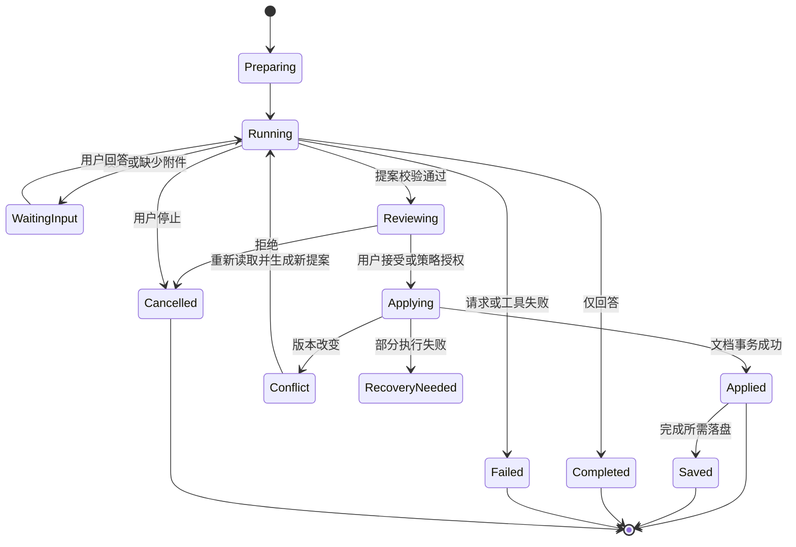

# MarkdownIDE 技术项目文档

版本：V1.1 · 日期：2026-11-11 · 状态：待实施技术设计。

关联：[需求文档](01-产品需求文档.md) · [总体与 AI 集成方案](02-总体与AI集成方案.md)。本文件中的接口、类型、目录和状态均为项目设计，非已经存在的 SDK 或代码。示例说明协议，不能直接当成完整生产实现。

## 1. 技术基线

| 层级 | 技术 | 责任与约束 |
| --- | --- | --- |
| 桌面 | Electron，受支持稳定版 | 统一 Chromium；版本在 Spike 后由锁文件固定，不能盲目沿用旧版 |
| 本地后端 | Electron 内置 Node.js + TypeScript strict | Main 服务、权限、持久化；Node 版本跟随 Electron |
| 前端 | Vue 3、Pinia、TypeScript、Vite | 三栏 UI、AI 任务、差异和主题设置 |
| 编辑核心 | 首选验证 Muya/MarkText + 源码编辑器 | 通过 EditorAdapter 包装；CodeMirror 版本以实际内核适配为准，升级到 6 单列任务 |
| 解析与索引 | 编辑器现有解析器优先；必要时 unified/remark + GFM | 必须验证两端方言和 source position 一致，避免同文异义 |
| 数学与图表 | KaTeX、Mermaid | 限制 HTML/链接行为，视口按需渲染 |
| 数据校验 | Zod + 生成 JSON Schema | 内部协议单一来源；转换为各 Provider 支持的 Schema 子集 |
| 模型 | ProviderAdapter + 对应官方 SDK/HTTP | SSE/流事件统一；不引入必须依赖某厂商的业务类型 |
| 文件监听 | Node 异步文件 API、按需 chokidar | 合并事件、排除自写回声、识别真实外部冲突 |
| 凭据 | SecretService + OS 安全存储适配 | 检测安全后端，不以明文自动降级 |
| 转换 | Chromium HTML/PDF + Pandoc 子进程 | PDF 排版在 Renderer；Pandoc 版本/路径可配置 |
| 测试 | Vitest + Playwright + 文件故障注入 | 单元、契约、端到端、真实模型评估、视觉金样 |
| 工程 | pnpm、electron-vite、electron-builder（建议） | 锁文件、CI 分平台打包、签名和校验和 |

首版不需要 Go/Rust 服务、Express 本机 HTTP 服务或远程业务服务器。SQLite 只在历史/搜索数据量证明需要时引入，文稿原文始终是普通文件，不以数据库替代。

依赖是否能采用 MIT 发布，以选定提交的许可证、第三方依赖和再分发方式审核为准；不能把“项目主许可证 MIT”当作所有字体、主题、图标和转换器的许可证结论。

## 2. 进程与信任边界

| 进程 | 持有内容 | 允许行为 |
| --- | --- | --- |
| Renderer | 编辑视图、选区、面板状态、用户可见任务事件 | 通过窄接口访问本地服务，不获得密钥或 Node 通用能力 |
| Preload | 固定 API 封装 | 参数传递、监听解绑，不公开通用 send/invoke |
| Main | 会话注册、授权、文件路径、持久化、凭据访问 | 校验发起窗口及工作区，执行批准的变更 |
| Agent Utility | 任务循环、必要上下文、Provider 临时凭据 | 请求限定工具；取消后销毁凭据引用和任务资源 |
| Parse Worker | 文本快照、解析缓存 | 解析、定位、索引，不访问凭据 |
| 导出 Renderer | 经清洗的文稿和主题资源 | 排版/printToPDF，不携带业务 Preload 或文档写权限 |
| Pandoc 进程 | 明确输入和参数 | 格式转换，无默认任意用户过滤器或 Shell 命令 |

Main 必须开启 `contextIsolation` 和 Renderer Sandbox，关闭 `nodeIntegration`，使用限制性 CSP；拒绝非应用页面导航，校验 IPC sender/frame。[Electron 安全建议](https://www.electronjs.org/docs/latest/tutorial/security)

UtilityProcess 不是任意代码安全沙箱；不能因此执行模型生成的 JS、Shell 或不受信的用户脚本。我们提供的是有限的文档业务工具。

## 3. 建议代码目录

```text
MarkdownIDE/dev/
├── package.json
├── pnpm-lock.yaml
├── electron.vite.config.ts
├── src/
│   ├── main/
│   │   ├── app/                 # 生命周期、窗口、工作区
│   │   ├── ipc/                 # 验证、路由、订阅
│   │   ├── documents/           # 会话、保存、恢复、文件注册
│   │   ├── changes/             # 校验、执行、提交日志、恢复
│   │   ├── permissions/         # 范围、冻结提案授权
│   │   ├── secrets/             # OS 凭据与会话凭据
│   │   ├── themes/              # 导入、资源、兼容报告
│   │   └── exports/             # PDF/HTML/Pandoc 调度
│   ├── preload/index.ts
│   ├── renderer/
│   │   ├── shell/               # 三栏和全局菜单
│   │   ├── editor/              # EditorAdapter、模式、事务
│   │   ├── panels/              # 元素、文件、目录
│   │   ├── ai/                  # 输入、状态、澄清、Review
│   │   ├── settings/            # 外观、模型、导出
│   │   └── stores/
│   ├── agent/
│   │   ├── controller.ts        # 有界工具循环
│   │   ├── tools/               # 读工具与 propose_changes
│   │   ├── providers/           # official/local/custom adapters
│   │   ├── context/             # 最小上下文与预算
│   │   └── attachments/         # 图片/OCR 输入处理
│   ├── workers/parse.ts
│   └── shared/
│       ├── schemas/             # 文档、任务、工具、变更
│       ├── errors.ts
│       └── events.ts
├── tests/
│   ├── unit/
│   ├── contract/
│   ├── e2e/
│   ├── fixtures/                # Markdown、图片、主题金样
│   ├── fault-injection/
│   └── model-evals/
└── resources/                   # 品牌、默认主题、转换资源
```

此目录为建议，当前 `dev` 尚未建立这套代码。本次仅编写文档，不创建应用脚手架。

## 4. 文档模型与会话同步

```ts
type DocumentSnapshot = {
  documentId: string;
  workspaceId: string | null;
  relativePath: string | null; // 新建未保存文档可为空
  revision: number;
  text: string;
  contentHash: string;
  dirty: boolean;
  diskFingerprint: string | null;
  eol: 'lf' | 'crlf' | 'mixed';
  encoding: 'utf8';
};

type SectionRef = {
  documentId: string;
  revision: number;
  sectionId: string;
  level: number;
  title: string;
  headingPath: string[];
  ordinalAtLevel: number;
  headingStart: number;
  headingEnd: number;
  sectionEnd: number;
};
```

### 4.1 约定

- 内存偏移统一使用零基 UTF-16 code unit，范围结束不包含该位置；磁盘编码 UTF-8，二者不可混用。
- 内容摘要基于精确文本，不在计算前自动 trim、换行归一化或格式化。
- 保留原 EOL 与 BOM 策略；新建默认 UTF-8。混合 EOL 不自动全篇转换。
- revision 在会话内单调递增；任何应用到文档模型的用户/AI/重载修改都改变 revision。
- Section ID 属于快照，不能把 slug 当永久 ID；重复标题必须拥有不同 ID。
- 遇到代码块中的 `##` 不计标题；Setext 标题、嵌套容器等由解析器处理，不能用行首正则替代完整标题解析。

### 4.2 单写入拥有者

Renderer 内核执行编辑事务；Main DocumentSession 是跨窗口/文件/Agent 的协调者。每次用户编辑发送带 baseRevision 的增量，Main 顺序确认并分配新 revision。AI 读取前等待拥有者完成必要的同步 barrier，再产生不可变快照。

应用 AI 变更时 Main 校验 snapshot，持有短时文档提交队列，通过 EditorAdapter 在最新 revision 上执行一个原子编辑事务，收到确认后更新 Main 快照。若发送到 Renderer 与实际执行之间用户继续编辑，Renderer 的版本校验也必须拒绝旧变更。主进程不能在未收到内核确认时向模型报告成功。

多窗口相同路径按真实物理路径归一注册；只允许一个写入拥有者。只读视图按会话订阅更新，避免最后保存覆盖另一窗口修改。

## 5. EditorAdapter 接口

```ts
interface EditorAdapter {
  getSnapshot(): DocumentSnapshot;
  getSelection(): { from: number; to: number; revision: number };
  applyEdits(input: {
    expectedRevision: number;
    undoGroupId: string;
    edits: Array<{ from: number; to: number; insert: string }>;
  }): Promise<{ revision: number; contentHash: string }>;
  revealRange(from: number, to: number): void;
  switchMode(mode: 'live' | 'source' | 'split'): Promise<void>;
}
```

适配器需要验证内核确实支持事务分组及版本一致性。模式不是三份独立文档副本。若 Muya 只能整体导入导出，需要先开发事务适配和源位置映射；不能在每次模式切换时重建文档并丢失撤销栈。

源码/预览同步以 AST/source mapping 为目标；比例同步只可作为早期降级，不能在生产验收中当作精确定位。中文 IME composition 期间不插入 AI 修改，应等待组合输入结束并重新校验版本。

## 6. 工具注册与文档访问

### 6.1 模型可见工具

| 工具 | 核心参数 | 返回 | 约束 |
| --- | --- | --- | --- |
| `get_active_document` | taskId | 文档身份、revision、选区、目录摘要 | 默认不返回整篇正文 |
| `list_workspace_files` | workspaceId、cursor、limit | 文件 ID、相对路径、下一页 | 排除恢复区、密钥、构建目录 |
| `search_documents` | query、fileIds、cursor | 文件 ID、匹配片段、版本 | 限范围、限条数、可取消 |
| `get_document_outline` | documentId | SectionRef 列表 | 使用最新授权快照 |
| `read_section` | documentId、sectionId、revision | 精确源文本、范围、hash | 版本不符返回冲突，不偷换 ID |
| `read_document` | documentId、revision、range | 所需文本片段 | 受任务预算控制 |
| `request_clarification` | question、candidateIds | pending/用户答案 | 挂起等待，不继续依赖写入 |
| `propose_changes` | ProposalInput | changeSetId、校验/Review 状态 | 仅提交建议，不直接写入 |

ID 必须来自应用 registry，未注册 ID 返回错误。工具不接受任意绝对路径。读取工作区外单文件需要用户主动选择并创建独立授权，授权不是由模型提供的路径字符串产生。

### 6.2 变更操作

```ts
type VersionGuard = {
  documentId: string;
  baseRevision: number;
  expectedContentHash: string;
};
type TargetAnchor = {
  sectionId: string;
  position: 'after_heading' | 'section_end';
};
type Cell = { text: string; status: 'recognized' | 'uncertain' | 'empty' };

type ChangeOperation =
  | { kind: 'insert_table'; guard: VersionGuard; anchor: TargetAnchor;
      table: { columnCount: number; totalRows: number;
        header: Cell[]; rows: Cell[][] } }
  | { kind: 'replace_range'; guard: VersionGuard;
      from: number; to: number; expectedOldText: string; newText: string }
  | { kind: 'create_document'; workspaceId: string;
      relativePath: string; content: string; ifExists: 'fail' }
  | { kind: 'delete_document'; guard: VersionGuard;
      recovery: 'trash_or_recovery' };

type ProposalInput = {
  taskId: string;
  summary: string;
  operations: ChangeOperation[];
  attachmentIds: string[];
};
```

`totalRows` 包含表头且不包含 Markdown 分隔符行，必须等于 `rows.length + 1`；每行和 header 都等于 columnCount。长度/数量限制由服务端检查。未知 OCR 内容通过 status 表达，不能靠“置信度很高”的模型描述跳过校验。

`replace_range` 可以用于正文增删（插入时 from=to，删除时 newText 为空）。即使来自模型，offset 也不能直接信任，必须严格匹配版本、旧文本和 AST 边界。高频结构操作优先用语义工具由代码计算范围。

初版对同一文档一份提案以一个读取快照为基准；规范化后检查不重叠范围，按偏移降序应用。两个操作在同一插入点时按显式顺序合并；重叠或有依赖的改写拆成新的提案，不允许模型任意交错执行。

### 6.3 ChangeSet 与授权

Main 为提案生成 `changeSetId`、规范化 edits、风险类别、版本集合和 `proposalDigest`。digest 覆盖路径、操作、内容、目标快照与资源摘要；UI 展示的是冻结后的这一份提案。

用户确认调用内部 `changes.accept(changeSetId, proposalDigest)`。Main 创建授权记录；apply 校验当前用户选择、摘要和版本全部一致。自动应用也通过同一策略引擎产生授权，而不是绕过 apply。

文件覆盖不走 `create_document.ifExists=overwrite`。先明确呈现已有文件及差异，用户批准后生成带现有版本约束的替换提案。

## 7. IPC 契约

```ts
interface DesktopAPI {
  documents: {
    openByDialog(): Promise<DocumentSnapshot | null>;
    snapshot(documentId: string): Promise<DocumentSnapshot>;
    save(documentId: string, expectedRevision: number): Promise<SaveResult>;
  };
  agent: {
    start(input: StartTaskInput): Promise<{ taskId: string }>;
    cancel(taskId: string): Promise<void>;
    answer(taskId: string, answer: ClarificationAnswer): Promise<void>;
    subscribe(taskId: string, listener: (event: TaskEvent) => void): () => void;
  };
  changes: {
    review(changeSetId: string): Promise<ReviewData>;
    accept(changeSetId: string, proposalDigest: string): Promise<ApplyResult>;
    reject(changeSetId: string): Promise<void>;
    restore(transactionId: string): Promise<RestoreResult>;
  };
}
```

SaveResult 等类型在 shared schemas 定义，至少区分 saved / conflict / failed 以及 revision 和磁盘指纹。Preload 只暴露这些具体方法；订阅函数必须返回解绑方法，限制同一窗口订阅数量。运行时校验 sender、任务所属窗口、消息大小和 schema，不只依赖 TypeScript 编译检查。

任务事件封装 `taskId`、`sequence`、`timestamp` 与判别联合 payload；建议类型包括 started、phase、text_delta、tool_started、tool_finished、clarification、proposal_ready、applied、failed、cancelled。前端去重并检测序号缺口，通过任务快照接口恢复状态，不把 IPC 重连当新任务。

## 8. Provider 接口与任务循环

```ts
interface AIProvider {
  validateConfig(signal: AbortSignal): Promise<ConnectionResult>;
  getCapabilities(model: string): Promise<ModelCapabilities>;
  runTurn(request: ProviderTurn, signal: AbortSignal): AsyncIterable<ProviderEvent>;
}

type ModelCapabilities = {
  text: boolean;
  vision: boolean;
  toolCalling: boolean;
  structuredOutput: boolean;
  streaming: boolean;
};
```

`ProviderEvent` 归一为 text_delta / tool_call_ready / usage / completed / error。`tool_call_ready` 必须表示完整参数，而非尚未结束的流式 JSON。只有完整调用通过校验后才执行工具；不执行半段参数。

OpenAI 适配器按官方工具调用流程保留调用 ID 与必要的响应项，再把工具执行结果返回模型。其他 Provider 各自实现消息回放，不只拼接普通聊天文本。[工具调用](https://developers.openai.com/api/docs/guides/function-calling)

概念伪代码：

```text
start: 冻结用户任务、授权范围、附件和任务预算
repeat（未超过轮数/时间/用量预算）:
  请求 Provider，流式展示状态和文字
  若取消/拒绝/截断：进入对应状态，不执行不完整调用
  收集完整工具调用并检查 schema、范围和预算
  依次执行依赖工具；只读独立任务才允许并行
  若需要澄清：挂起，等待用户答案
  若产生有效提案：进入待审阅，停止继续生成写入计划
  将工具结果及协议要求的历史项交给 Provider 续轮
  若结束且无提案：作为回答完成
apply: 由应用授权与事务执行器处理
final: 依据实际结果说明已应用/待保存/失败，而非模型文字
```

建议初始预算：最多 12 轮、每轮最多 8 个读取工具、总执行时间 120s，用户等待澄清/Review 的时间不计入模型执行预算。长任务可显式延长；这些是可配置工程起点，需根据实测调整。取消使用 AbortController，并清理订阅/进程资源。

同一任务涉及同文件的依赖操作串行；工具去重键绑定 taskId、轮次、callId 和参数摘要，不能只用 arguments 去重，否则合法重复读取会被误拦。不同任务需独立执行队列与幂等记录。

## 9. Agent 状态机



Applied 与 Saved 必须分开。若自动保存失败，任务显示“修改已应用，保存失败”，保留编辑内容与恢复副本。Applying 取消时停止尚未执行的操作，已执行项进入结果账本，不能假报整单 cancelled 且无变更。

RecoveryNeeded 不自动变成 Failed 后清理日志；必须保留已提交项和恢复入口。模型重连不重新触发同一 ChangeSet 的提交。

## 10. 图片输入管线

1. 用户粘贴/拖入/选择图片，应用验证 MIME、真实文件头、尺寸与大小。
2. AttachmentService 分配 ID，保存到任务临时区；记录来源、hash、缩略图和所属任务。
3. 只读图像模型使用其支持的输入方式和 detail；不盲目把所有图片压到难以识别的统一尺寸。
4. 提取 `header`、`rows`、不确定项与来源附件 ID；复杂表格按区域或页分块。
5. 应用校验形状、目标容量和空值，再转成语义表格。
6. 展示图片与结构化结果，允许用户修正识别值；修改后的提案重新计算 digest。
7. 任务结束按保留设置清理附件；若文稿引用图片，转存文档资源区，不能删除仍被引用的资源。

图片理解是模型视觉能力，不是图像生成。模型输入限制、价格和支持形式按实际 Provider 文档与探测能力处理，不写死某个宣传上限。[图片与视觉](https://developers.openai.com/api/docs/guides/images-vision)

本地 OCR 作为可选组件；仅 OCR 文字无法保证表格结构，必要时增加布局分析。关键数值、日期和金额遇到不确定识别时保留待核对，禁用直接自动应用。

## 11. 校验、提交与恢复

### 11.1 校验顺序

Schema → task/workspace ownership → 资源和路径 → 版本/hash → 语义锚点 → 范围/旧文本 → 表格形状 → 重叠冲突 → 风险策略 → Review 摘要。

路径校验包括规范化、绝对路径解析、真实父目录和符号链接逃逸，不能只使用字符串 startsWith 判断目录包含。执行前在提交队列内重新核对目标，降低检查与使用之间状态变化的风险。工作区目录新增/重命名事件会使相关提案失效。

### 11.2 单文件

打开文件：通过 EditorAdapter 事务应用为一个 undoGroup，Main 收到确认后更新会话。保存对期望 revision 取快照；若保存过程中又发生修改，只把对应已落盘 revision 标记为 saved，不能把整个会话误标干净。

未打开文件：读取 hash → 准备恢复数据 → 同目录临时文件写入并 flush → 再核对原目标 → 平台合适的替换策略 → 更新磁盘指纹和日志。测试 Windows 文件锁、只读、磁盘满和断电窗口；不把抽象 rename 当作所有平台上的持久性保证。

新建：验证父目录真实路径，排他创建，若目标已出现返回 FILE_EXISTS。重复 task retry 使用已记录的执行结果。

### 11.3 多文件日志

每个事务记录 transactionId、changeSetId、授权摘要、每个文件的 before/after hash、恢复副本引用、磁盘/编辑器状态和 step 状态。日志本身不记录 API Key，并按内容隐私级别保护恢复副本。

步骤：PREPARED → APPLYING → COMMITTED；失败可进入 PARTIALLY_APPLIED / RECOVERY_NEEDED / RESTORED。开始任何写入前持久化恢复索引；每个实际副作用后更新日志，重启时通过磁盘 hash 补判“副作用已成功但日志尚未刷入”的窗口。

恢复采用 compare-and-restore：只有现内容仍等于本次 after hash 才可无冲突恢复。否则展示冲突并保留两个版本。多文件提交不声称全局原子性。

### 11.4 删除和恢复

文件删除先处理 dirty：保存后删除/保留恢复副本后删除/取消。优先系统回收站；系统 API 无法稳定返回恢复句柄时，应在应用恢复区保留必要映射和副本后再删除。应用自己的恢复流程不依赖操作系统回收站一定提供可编程还原。

未打开文件删除校验 hash；打开文件关闭/标记状态需等实际删除成功。删除失败保留标签与内容。恢复时检查同名文件，不覆盖。恢复副本加保留期与容量上限，但未完成事务所需数据不得自动清理。

## 12. 持久化、配置与凭据

```text
<Electron userData>/
├── settings.json            # 外观、编辑、保存策略
├── providers.json           # endpoint/model/能力，只有 secretRef
├── secrets/                 # 受 OS 加密保护的密文（若使用此实现）
├── themes/                  # 导入主题与资源、兼容报告
├── sessions/                # 可恢复未保存文稿
├── changes/                 # ChangeSet 元数据与事务日志
├── recovery/                # 恢复副本，按保留策略管理
└── logs/                    # 脱敏的技术日志
```

使用 schemaVersion 和迁移函数，迁移先备份。日志默认只包含任务 ID、耗时、操作数量和错误码，不记录文稿正文/图片/密钥。完整任务历史与文稿恢复副本是内容数据，需可查看和清理。

SecretService 检测安全存储可用性和平台后端；Linux 使用弱化后端（例如 basic_text）时不得标记为“安全保存”，改为仅本次会话使用或提示配置系统密钥服务。safeStorage 的安全语义因平台而异，不能宣称抵御同用户全部进程；按锁定 Electron 版本选择受支持接口。[safeStorage](https://www.electronjs.org/docs/latest/api/safe-storage)

Provider 地址与密钥引用可持久化；自定义 Headers 中的认证值也视作密钥，不能遗漏到配置导出。不要把查询字符串中的 token 写入日志。用户可选择本地地址，但“本地”标签只说明请求连接，不能证明服务进程不再转发到外部。

## 13. 主题和导入导出实现

ThemeService 解析 CSS、@import、url() 和资源相对路径，复制合法本地资源到主题目录并检查目录包含。拒绝脚本和不受信的远程资源；隔离主题容器，维护 `#write` 等兼容映射；不通过简单全局字符串替换实现 CSS 解析。

导入前生成兼容报告和可恢复配置。应用本身的浅/深主题 Token 与正文主题独立。固定主题、文稿语料、字体和 Chromium 版本拍摄视觉基准，区分抗锯齿差异与布局退化。

ExportService 收到快照后生成经清洗 HTML 与资源映射。PDF 在沙箱导出窗口完成字体、图片、公式、图表加载后调用 printToPDF，再关闭窗口和清理临时资源。设置超时与缺失资源反馈。[webContents](https://www.electronjs.org/docs/latest/api/web-contents)

Pandoc 使用确定的二进制路径与参数数组（shell=false），仅内置可信 Profile；外来文稿的 Front Matter 不得自动启用任意过滤器、模板脚本或系统命令。转换器安装/下载采用固定来源、版本和校验和；是否随包分发在许可证审计后确定。DOCX 采用 reference.docx，LaTeX 采用对应模板，不强制复现 CSS。

## 14. 错误模型

| 错误码 | 场景 | UI/恢复行为 |
| --- | --- | --- |
| `TARGET_AMBIGUOUS` | 多个标题/文件候选 | 请求用户选择 |
| `REVISION_CONFLICT` | 内核版本改变 | 冻结旧提案，重新读取 |
| `DISK_CONFLICT` | 外部进程修改 | 展示比较/另存，不直接覆盖 |
| `FILE_EXISTS` | 创建目标重名 | 改名或重新生成覆盖 Review |
| `OUT_OF_SCOPE` | 越过授权文件范围 | 说明需要用户主动选择目标 |
| `CAPABILITY_MISSING` | 模型无视觉或工具调用 | 切模型/可用 OCR/建议模式 |
| `IMAGE_UNCERTAIN` | 图片关键内容无法识别 | 显示待核对单元格 |
| `INVALID_PROPOSAL` | Schema、形状或范围不符 | 不执行；有限重试或解释 |
| `PROVIDER_AUTH` | 认证失败 | 跳转配置，不输出凭据 |
| `PROVIDER_RATE_LIMIT` | 429 | 有界退避，可停止 |
| `PROVIDER_TIMEOUT` | 超时 | 保留任务，允许有界重试 |
| `PARTIAL_APPLY` | 多文件部分失败 | 列出成功/失败/未执行，保留恢复 |
| `RECOVERY_CONFLICT` | 恢复会覆盖新内容 | 展示两版本，人工选择 |
| `SAVE_FAILED` | 磁盘/权限/文件锁 | 保留 dirty 与恢复副本 |
| `CANCELLED` | 用户停止 | 不执行新副作用，显示已有结果 |

错误协议包含 code、用户可见说明、retryable、taskId/transactionId 与脱敏技术详情。不能在 UI 回显原始 HTTP Header 或包含密钥的完整 URL。

## 15. 测试与发布门槛

### 15.1 确定性测试

- 章节边界：重复标题、H1/H2/H3、Setext、末尾章节、代码块伪标题、CRLF、Emoji UTF-16 偏移。
- 表格：4×2 含表头、列数错误、空单元格、未知值、竖线/换行转义、数据超限、合并结构降级。
- 变更：空插入、范围外、oldText 不符、重叠、两次插入同位置、一次撤销、多次用户修改。
- 会话：dirty 缓冲区、模式切换、IME composition、多窗口写入拥有者、保存过程中继续编辑。
- 权限：路径遍历、符号链接、同名前缀目录、绝对路径、非法 ID、文稿/图片中的注入指令。
- 事务：文件锁、磁盘满、进程异常、重名竞态、日志刷盘窗口、部分恢复冲突。

### 15.2 Provider 契约与模型评估

单元/端到端使用确定性 Mock；Provider 契约测试验证真实消息、完整工具参数、取消、认证、限流、截断和图片支持。模型评估与应用测试分开，不能靠 Mock 通过宣称真实 AI 正确。

至少 40 个任务按需求 AC-03～AC-10 及正常用例组织。每条记录用户指令、输入文稿/图片金样、预期操作、可接受澄清、模型配置和最终磁盘/缓冲区结果。正常任务端到端成功目标 ≥90%，以最终结构/目标/数据为准，不能只判回复文本。

关键应用约束在固定负例中必须全部通过：未授权写入、静默覆盖和重复执行为零。视觉识别的不确定性不可用一个总成功率掩盖。

### 15.3 UI 与非功能

覆盖主界面、分屏、AI 展开收起、文件切换、任务执行、澄清、Review、冲突和恢复、主题深浅色。测试键盘、100%/150%/200% 系统缩放、目标桌面宽度以及中文输入法。

性能指标、设备和样本次数以需求第 10 节为准；记录整棵进程树内存及冷启动条件。Electron 打包版与开发服务器分别测量，不混用。

### 15.4 发布

CI 依次执行类型检查、lint、单元/契约 Mock、端到端、构建、依赖与许可检查、安装包签名与校验和。真实模型评估使用专门测试配置和配额，不把个人密钥写进仓库或日志。

提供许可证、第三方声明、SBOM、更新说明和回滚策略。自动更新可关闭；更新包校验失败不安装。Windows/macOS/Linux 分平台构建与安装验证，不把一次 Windows 运行当作全平台通过。

## 16. 实施任务与依赖

| 工作包 | 输出 | 依赖 | 需求/验收 |
| --- | --- | --- | --- |
| W0 技术验证 | 内核、主题、命令、保存和模型 Spike 报告 | 无 | 方案 S1～S6 |
| W1 工程基础 | Electron/Vue 工程、IPC、CI、品牌 | W0 内核决策 | LIC-01、LOC-01 |
| W2 文档基础 | Session、EditorAdapter、原子保存与恢复 | W1 | EDT/FIL、AC-02/03 |
| W3 UI 实装 | 三栏、元素、目录、模式、AI 面板 | W1/W2 | UI、AC-01 |
| W4 修改引擎 | Section 定位、ChangeSet、Review、undo | W2/W3 | AGT-02/07/08、AC-05/06 |
| W5 Provider 与 Agent | 工具循环、配置、凭据、状态、取消 | W2/W4 | MOD、AGT-01/10、AC-09/13 |
| W6 图片填表 | 附件、视觉、结构化表格、预览 | W4/W5 | AGT-03、AC-04 |
| W7 文件 CRUD/多文件 | 搜索、创建、删除、日志与恢复 | W4/W5 | AGT-04/05/06/09、AC-07/08/10 |
| W8 主题/转换 | 隔离兼容、Pandoc、打印 | W2/W3 | THM/IO、AC-11/12 |
| W9 完整验收发布 | 性能、模型评估、安装包矩阵 | W1～W8 | 所有 P0/P1 |

实际人力、工期与官方 Provider 数量在 W0 后估算并冻结。UI 外壳、主题和 Provider 可由团队并行开发，但统一协议、DocumentSession 与 EditEngine 应先建立，避免多个模块分别写文件。

## 17. 风险与未决技术项

| 风险 | 预防/出口 |
| --- | --- |
| 内核无法暴露可靠事务和选区映射 | W0 验证，决定完整 Fork/适配/替代；不绕过内核写 DOM |
| 前后解析器方言不一致 | 固定共同语料和 source mapping；先复用同一语法规则 |
| Agent 读到旧缓冲区 | session barrier、双端 revision、单写入拥有者 |
| 主题过度依赖 Typora 内部 DOM | A/B 分级、兼容矩阵、可回退，不宣传 100% |
| 协议兼容但模型能力不足 | 实际任务评估，降级到建议模式 |
| 文件系统全局事务缺失 | 持久化日志、逐步账本、compare-and-restore |
| 凭据平台后端不安全 | 运行时检测，不安全时仅会话使用 |
| 原型被当作生产实现 | 明确资产边界，不复用简化解析/模拟保存 |

## 18. 官方核验入口

核对日期：2026-11-11。实施时应依据锁定版本再次核对接口，不固定未经验证的具体模型名或价格。

- [Electron 安全](https://www.electronjs.org/docs/latest/tutorial/security)
- [Electron 进程模型](https://www.electronjs.org/docs/latest/tutorial/process-model)
- [Electron safeStorage](https://www.electronjs.org/docs/latest/api/safe-storage)
- [Electron webContents / printToPDF](https://www.electronjs.org/docs/latest/api/web-contents)
- [OpenAI Function Calling](https://developers.openai.com/api/docs/guides/function-calling)
- [OpenAI Structured Outputs](https://developers.openai.com/api/docs/guides/structured-outputs)
- [OpenAI 图片与视觉](https://developers.openai.com/api/docs/guides/images-vision)
- [MarkText 仓库](https://github.com/marktext/marktext)
- [Typora 主题机制](https://support.typora.io/About-Themes/)
- [Pandoc 官方手册](https://pandoc.org/MANUAL.html)

## 19. 预测与参考材料技术扩展（V1.1 文档新增）

实现 PRE-01～PRE-06、REF-01～REF-08，复用第 4～11 节文档事务。以下为项目自定义设计，不是模型厂商已有接口。

### 19.1 新增模块与目录

```text
src/
├── main/references/          # SourceAsset registry、授权、网页获取
├── main/styles/              # StyleProfile 配置与主题候选事务
├── prediction/               # 调度、候选校验、取消、Provider 调用
├── workers/extractors/        # MD/TXT、DOCX、PDF 提取和分块
├── agent/context/            # 参考片段选择、预算、来源映射
├── renderer/editor/ghost/    # 非文稿装饰层、接受/拒绝交互
├── renderer/ai/references/   # 素材标签、解析状态、来源预览
└── shared/schemas/           # SourceAsset、SourceChunk、Prediction
```

解析复杂文件放在可取消 Worker/Utility，限制输入体积、解压后大小、页数、耗时和峰值内存；文件扩展名不能代替真实内容检查。PDF 提取、DOCX 表格解析等库在 Spike 后选定并固定许可和版本，不把 Pandoc 当作完整 PDF/OCR 解析器。

### 19.2 来源、片段和引用协议

```ts
type ReferenceRole = 'facts' | 'data' | 'writing_style' | 'visual_style';
type SourceLocator =
  | { kind: 'document'; documentId: string | null; relativePath: string | null;
      revision: number | null; headingPath: string[];
      fromUtf16: number; toUtf16: number }
  | { kind: 'pdf'; page: number;
      bbox: { x: number; y: number; w: number; h: number } | null }
  | { kind: 'docx'; paragraphId: string; tableId: string | null }
  | { kind: 'web'; finalUrl: string; fragmentId: string }
  | { kind: 'image'; attachmentId: string;
      region: { x: number; y: number; w: number; h: number } | null };

type SourceAsset = {
  sourceId: string;
  sourceVersion: number;
  kind: 'document' | 'pdf' | 'docx' | 'web' | 'image';
  title: string;
  roles: ReferenceRole[];
  contentHash: string | null;
  fetchedAt: string | null;
  requestedUrl: string | null;
  status: 'queued' | 'parsing' | 'ready' | 'partial' | 'failed' | 'removed';
  accessGrantId: string;
};

type SourceChunk = {
  sourceId: string;
  sourceVersion: number;
  chunkId: string;
  text: string;
  locator: SourceLocator;
  uncertain: boolean;
};

type EvidenceRef = {
  sourceId: string;
  sourceVersion: number;
  chunkId: string;
  relation: 'supports' | 'direct_quote' | 'style_only';
  quote: string | null;
};
```

SourceAsset.contentHash 未产生时不得进入可用引用集合；SourceChunk 只能在 ready 或明确可用的 partial 部分生成。sourceVersion 改变时旧 chunkId 不复用。DOCX 段落 ID 由提取器生成并绑定文件 hash，不承诺 Word 原始稳定 ID；无精确页码时不编造页码。

PDF page 从 1 开始；bbox 与 image region 统一为原页面/图像坐标系归一化 0..1 的左上起点，缺少可靠定位则为 null。文本 offsets 仍用 UTF-16；网页 fragmentId 由本地正文快照生成，不假装等于网页 DOM 的原始 anchor。

EvidenceRef.relation 是模型提出的用途，应用结合 SourceAsset.roles 检查；style_only 不得用于事实支持。来源 hash、chunk ID 和 Locator 由本地提取器生成，模型只能引用已有值，不能自行构造文件路径或远程来源。

生成响应包含内容块及其 EvidenceRef 列表；本地 SourceMap 将渲染后的段落/表格单元格映射到内容块 ID。不得要求模型猜测最终 Markdown 的字符偏移来绑定引用。

### 19.3 提取与检索

读取顺序：已打开文档的同步快照 → 未打开的已授权本地文件 → 用户选择的公开网页 → 可用 Provider 原生文件输入。最后一项是适配选择而非必须顺序，所有路径都要留下应用自己的源版本和 Locator。

- MD/TXT 保留原范围及标题路径；引用已选的未保存内容时标识“当前编辑版本”。
- DOCX 提取段落与表格，嵌图作为独立附件登记；不声称文字提取包含全部图像信息。
- PDF 按页提取，检测文本不足页，再决定 OCR/视觉降级；扫描件不因扩展名 PDF 就标记已读。
- 网页使用受控 fetch 和正文提取；主页面失败不自动切换到搜索结果摘要充当正文。
- 图片复用 AttachmentService，提取结构与不确定项；视觉样式用途可直接将图作为模型输入。

先按章节/页/段落切分，保留相邻结构，建立关键词检索。ContextBuilder 从用户指定范围与问题选择相关片段，记录被选和因预算被截断的片段；必要时请求缩小范围。完整网页/附件缓存本地优先，自动预测不再重复抓取或默认上传整件材料。

不同 Provider 的原生文件支持并不一致；直接上传文件前检测对应接口能力，文字解析丢失图片时明确降级。[OpenAI 文件输入](https://developers.openai.com/api/docs/guides/file-inputs)

### 19.4 StyleProfile

```ts
type StyleProfile = {
  profileId: string;
  version: number;
  scope: 'task' | 'document' | 'workspace';
  tone: string | null;
  audience: string | null;
  language: string | null;
  terminology: Record<string, string>;
  sampleSourceIds: string[];
  preferredStructures: string[];
};
```

写作 Profile 由用户选择和明确保存；预测接受记录默认不转成长期训练样本。配置导出不携带原文样例和敏感文档路径，只导出明确选定的非敏感字段。视觉偏好采用独立的 TypographyProfile（受支持主题 ID、字号、行高、宽度等有限字段），不向模型开放任意 CSS/JS 执行。

### 19.5 预测请求与候选

```ts
type PredictionContextKey = {
  documentId: string;
  revision: number;
  fromUtf16: number;
  toUtf16: number;
  sourceSetDigest: string;
  styleDigest: string;
  providerConfigVersion: number;
};
type PredictionRequest = {
  requestId: string;
  contextKey: PredictionContextKey;
  kind: 'continuation' | 'structure' | 'visual_style';
  prefix: string;
  suffix: string;
  sourceChunkIds: string[];
};
type PredictionCandidate = {
  candidateId: string;
  requestId: string;
  contextKey: PredictionContextKey;
  insertText: string; // 仅内容候选；视觉样式走独立受限 schema
  evidence: EvidenceRef[];
};
```

prefix/suffix 是光标前后有界文本，完整预算由 ContextBuilder 计算，保留已有后文以避免重复续写。候选限制长度，不允许内容预测返回文件删除/创建等操作。预测的模型参数、提示词版本与能力档位必须纳入内部缓存 key。

缓存分两层：来源快照/提取缓存与短期预测候选缓存。预测缓存以精确内容指纹、锚点、来源版本、风格、Provider/model 与提示版本为键；候选进入文稿前始终再比较当前 contextKey，不因缓存命中跳过校验。关闭工作区或撤销授权时清理对应缓存。

### 19.6 输入与调度

1. 监听文档输入、selection、compositionstart/end；通过编辑内核事件优先，不只监听 DOM keydown。
2. IME 开始、文档变更、焦点移出或选区移动，立即隐藏旧候选并 cancel request。
3. compositionend 后等待内核提交最新文本和会话 barrier，再重新计时；中文候选 Enter 不接受 AI 建议。
4. 自动模式 debounce 初值 800ms；每会话 1 个在途请求，初始每分钟 6 次，达到预算显示暂停状态。
5. 生成期间显式任务启动则抢占/取消预测；预测无独立写工具，无网页获取循环。
6. 完整候选收到后依次比较 requestId、document revision、选区、来源、style、Provider 版本。
7. 验证通过才展示装饰层。接受时再次校验，并进入应用管理的单次编辑事务；失败返回过期状态。
8. 停止网络不保证服务方停止计费，使用取消后的结果不得重新显示；后台副作用不会由丢弃候选触发。

compositionend 表示输入法组合输入完成或取消，还需结合编辑内核最终提交时点，不能把这个 DOM 事件当作所有状态已同步的保证。[MDN compositionend](https://developer.mozilla.org/en-US/docs/Web/API/Element/compositionend_event)

Ghost text 由编辑器 decoration/render layer 实现，不通过向 DOM 文稿直接插入文本模拟。DOM Range、选区、内核节点与源码 offsets 都以同一文档快照映射；主题只改变展示，不改变候选的文本身份。屏幕阅读器通过可配置的简短提示获知候选，不能每个 token 都朗读。

### 19.7 新增内部接口与模型工具

内部 IPC 增加：references.add/remove/status/preview、styles.get/save、prediction.request/cancel/accept/dismiss。add 支持用户选择文件/附件和明确输入 URL，按窗口与工作区授权；模型不能借用 UI add 接口增加任意网络目标。

模型工具增加 `list_task_sources`、`search_source_chunks`、`read_source_chunk`。参数只接受已授权 sourceId/chunkId；返回版本和 Locator。模型请求尚未读取的链接先进入显式参考选择/授权流程，不因工具调用文本自动允许访问内网或使用浏览器凭据。

ProposalInput（第 6 节）在 V1.1 协议中增加可选 `sourceSetDigest`、`styleDigest` 和按内容块绑定的 evidence。含参考生成的提案要求这些字段必填；资料移除、版本变化或用途改变会使提案失效，重新生成 Review。实际 Schema 使用带版本的判别类型，旧任务可迁移或标记需重新生成，不静默套用新字段默认值。

### 19.8 引用校验与导出

校验引用存在于本次发送清单，sourceVersion 和 chunkId 有效，直接引文与片段按明确的换行/空白规则匹配。只判断匹配不代表语义事实已得到支持；关键数字/日期可与结构化提取值比对，归纳推论需在 UI 标为推断。

Markdown 输出脚注 ID 由应用生成且避免与已有脚注冲突；来源列表记录标题、URL/相对路径、页/章节与抓取时间。HTML/PDF 导出保留来源文字与跳转，DOCX/EPUB 按格式支持降级为脚注或来源列表。跨机器不能使用绝对本机文件路径作为唯一引用；本地源可复制为可选资源包，或标记需要原文件。

结构化引用源映射可持久化在 userData 的 source-maps 中，保存 document hash 和段落/文本锚点；重新打开后需校验，文档被外部修改时失配项标为待定位。用户未选择输出脚注时，不宣传裸 Markdown 文件已经自带完整来源追踪。

### 19.9 网页获取与缓存规则

ReferenceFetcher 使用单独网络策略：只读 HTTP(S) 公网地址；拒绝 loopback、私有网段、link-local、云元数据目标以及重定向到这些位置。校验 DNS 与实际连接 IP，限制重定向次数、下载/解压后大小、超时与内容类型。避免仅校验域名后重新解析导致 DNS rebinding；使用具备连接层校验能力的客户端或受控代理。

不带浏览器 Cookie、Authorization 或系统代理中的隐含站点认证；不执行脚本。登录/付费/反爬/动态内容显示受限，用户可选择上传可用文件或粘贴内容。Provider 本机推理地址配置与 ReferenceFetcher 的公网限制分开管理。

缓存快照保留原始 hash、提取器版本和 fetchedAt；URL 并非不可变身份。刷新材料创建新版本，不让旧提案自动指向新正文。删除源时解除任务引用、取消候选，并依保留策略清理缓存；已经插入的正文和远程已发送内容不自动撤回。

### 19.10 测试、错误码和交付任务

新增错误：`SOURCE_UNREADABLE`、`SOURCE_STALE`、`SOURCE_CONFLICT`、`SOURCE_OUT_OF_SCOPE`、`SOURCE_BUDGET_EXCEEDED`、`CITATION_INVALID`、`PREDICTION_STALE`、`PREDICTION_DISABLED`。不要将预测过期显示成需要用户处理的红色失败弹窗，通常安静丢弃即可。

测试至少覆盖：IME/Tab 优先级；幽灵文本不落盘/导出；接受与一次撤销；光标/revision/风格/Provider/材料变更使候选失效；手动/自动模式与限频；网页重定向和私有地址；DOCX 内嵌图缺失；扫描 PDF 降级；引文伪造和参考冲突；样式参考不能作为事实；移除材料清理缓存；外部修改后的来源映射失配。

在原 Agent 评估集外新增至少 20 个固定用例，对应 AC-14～AC-19。指标分为响应时间、候选接受率、语义可用性、事实/引用一致性和过期丢弃正确率；接受率不替代正确性。输入延迟沿用原 P0 指标，预测不抢占正常编辑。

| 新工作包 | 依赖 | 输出 | 对应验收 |
| --- | --- | --- | --- |
| W10 参考材料基础 | W2/W5/W6 | 注册、MD/TXT/DOCX/PDF/网页/图片解析、来源映射、片段检索 | REF-01～REF-08、AC-17～AC-19 |
| W11 预测与风格 | W4/W5、W10 的已缓存来源接口 | 手动预测→可控自动预测、幽灵文本、StyleProfile、视觉样式预览 | PRE-01～PRE-06、AC-14～AC-16 |
| W12 增量质量验证 | W10/W11 | 新增 20 个用例、引用导出、隐私/性能/模型矩阵 | AC-14～AC-19 |

W9 最终发布门槛在本版扩展为依赖 W10～W12；保留 W0～W8 原任务编号。W10 不包含 P2 工作区向量库；P1 通过已选资料分块和关键词检索完成基础范围。此文档更新未实现预测、参考解析或 UI 改动。
